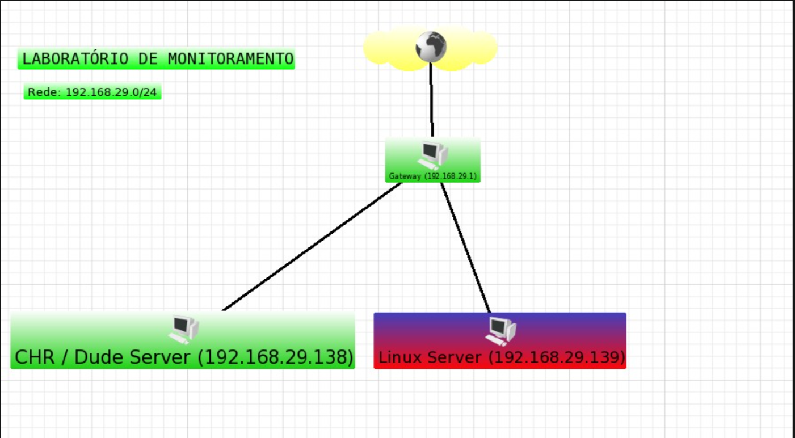
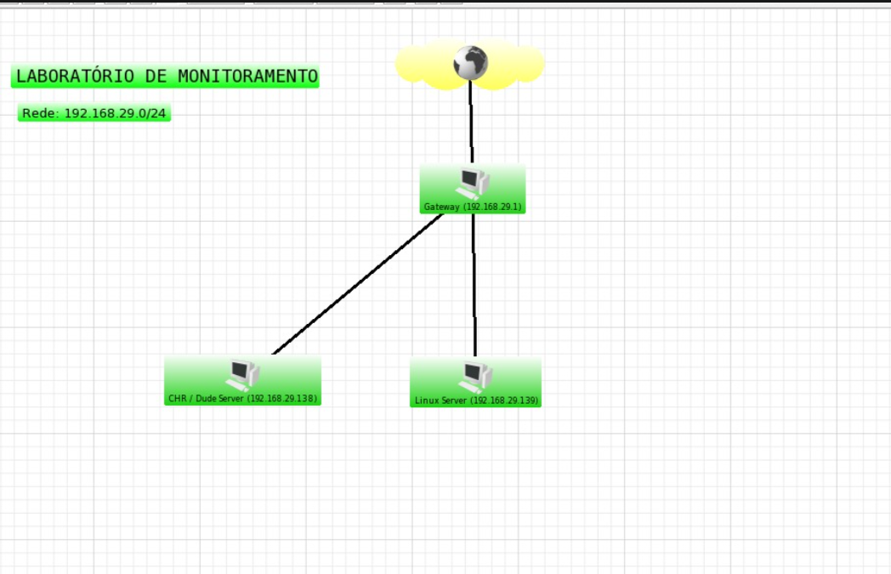

# Network Monitoring Lab — MikroTik CHR & The Dude

Laboratório prático de monitoramento de infraestrutura de rede utilizando **MikroTik CHR, RouterOS e The Dude**, com foco em disponibilidade, identificação de falhas de conectividade e acompanhamento de incidentes em um ambiente simulado de NOC (Network Operations Center).

## Objetivo

Implementar um ambiente virtualizado capaz de monitorar dispositivos de rede, identificar indisponibilidades e apresentar visualmente o estado dos equipamentos.

O projeto demonstra conhecimentos práticos em:

- Monitoramento de disponibilidade com ICMP.
- Configuração e administração básica do MikroTik RouterOS.
- Implantação do The Dude Server e Client.
- Descoberta e organização de dispositivos em mapas de rede.
- Diagnóstico de falhas de conectividade.
- Simulação de indisponibilidade e recuperação de serviços.

## Tecnologias utilizadas

| Tecnologia | Aplicação |
|---|---|
| MikroTik CHR 7.24.7 | Sistema de roteamento virtualizado |
| RouterOS | Administração da infraestrutura de rede |
| The Dude Server | Monitoramento centralizado |
| The Dude Client | Visualização da topologia e dos eventos |
| Oracle VirtualBox | Virtualização dos equipamentos |
| ICMP | Verificação de disponibilidade por ping |
| Linux | Máquina virtual utilizada nos testes |

## Ambiente de laboratório

Rede utilizada: `192.168.29.0/24`

| Dispositivo | Endereço IP | Função |
|---|---|---|
| Gateway | 192.168.29.1 | Gateway da rede |
| MikroTik CHR | 192.168.29.138 | Servidor The Dude |
| Linux Server | 192.168.29.139 | Máquina virtual monitorada |

O laboratório utiliza o MikroTik CHR como servidor de monitoramento, enquanto uma máquina virtual Linux funciona como alvo dos testes de disponibilidade.

## Monitoramento

Foi configurado o monitoramento ICMP para verificar periodicamente a comunicação entre o servidor de monitoramento e os dispositivos adicionados ao mapa.

A representação visual permite identificar os estados dos dispositivos e acompanhar a recuperação após uma falha.

## Simulação de incidente

**Cenário: indisponibilidade do Linux Server**

Durante o teste, o dispositivo `192.168.29.139` apresentou indisponibilidade no monitoramento.

O The Dude identificou a falha e alterou a representação visual do equipamento no mapa.

### Evidência 01 — Indisponibilidade (DOWN)

A captura demonstra o Linux Server sinalizado em vermelho, indicando falha na verificação de disponibilidade.

### Evidência 02 — Recuperação (UP)

Após o restabelecimento da comunicação, o monitoramento voltou a indicar disponibilidade, representada pela cor verde.

## Resultados obtidos

O laboratório permitiu:

- Implementar um servidor The Dude funcional em ambiente virtualizado.
- Configurar o monitoramento por ICMP.
- Organizar os equipamentos em um mapa de rede.
- Identificar visualmente uma indisponibilidade.
- Observar a recuperação do dispositivo monitorado.
- Documentar evidências de uma ocorrência de conectividade.

## Próximas melhorias

- Implementar monitoramento SNMP de interfaces de rede.
- Criar gráficos de consumo de banda.
- Configurar notificações de indisponibilidade.
- Acompanhar o histórico de eventos e falhas.
- Monitorar serviços TCP, além de ICMP.
- Documentar procedimentos básicos de troubleshooting.

## Contexto profissional

Este projeto simula atividades comuns em um NOC, como acompanhamento de disponibilidade, identificação de falhas e análise inicial de incidentes de rede.

O objetivo é desenvolver e documentar conhecimentos práticos em monitoramento, redes de computadores e operação de infraestrutura.
:::